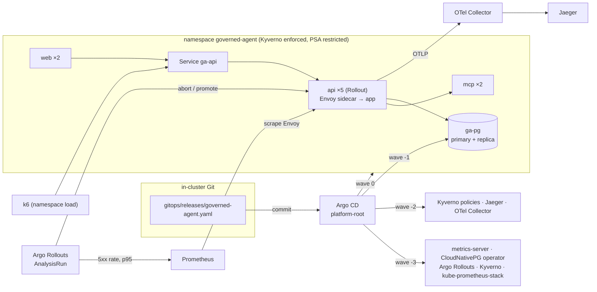

# platform-deployments

[](https://github.com/technobasant/platform-deployments/actions/workflows/ci.yml)
[](LICENSE)

**A release is a commit. A bad one stops itself.** A GitOps platform that deploys
[governed-agent](https://github.com/technobasant/governed-agent) v0.1.0, unchanged, to
a three-node Kubernetes cluster, and measures what happens when a release is good,
when it is bad, and when a node goes away.

Argo CD installs everything from one root Application: CloudNativePG and a
two-instance PostgreSQL cluster, Argo Rollouts, Kyverno, a trimmed
kube-prometheus-stack, the OpenTelemetry Collector and Jaeger, then the application.
The api ships as a canary that Prometheus analysis can abort; the other components
are Deployments with disruption budgets, probes, limits and default-deny network
policies. The same platform on AWS is described in Terraform, which is checked but
has never been applied.

## What the runs showed

All figures come from [MEASUREMENTS.md](MEASUREMENTS.md), which has the method, the
environment and every run. Medians of three runs unless stated.

| Question | Measured |
|---|---|
| Does a good release ship without errors? | 3 of 3 promoted at 20 req/s with **0 of 18,003 requests failed**, p95 21–24 ms. About 135 s from new ReplicaSet to full promotion, 120 s of it the canary's pauses |
| Does a bad release stop itself? | **6 of 6 aborted** (a release failing 30% of its requests): median 30–31 s from the bad pod being Ready to the abort. 11–39 of 4,800 requests failed per run (0.2–0.8%) |
| How much traffic reaches a bad canary? | 13% of requests while it was Ready from clients that open a connection per request; **1.7–10.9% from keep-alive clients**, against a replica weight of 20% |
| Could the analysis be trusted as first written? | No. It aborted a good release during a stall that slowed every pod (fixed: p95 judged against stable's), and promoted a bad release that had seen no traffic (fixed: no promotion before 30 canary requests) |
| Does draining a worker drop requests? | Drained in 31–39 s with the PodDisruptionBudget holding three api pods; 0, 0 and 28 requests failed; in the third run, with every pod on the remaining worker of a busy host, 25 requests timed out at 10 s |
| Are the admission rules enforced? | 6 of 6 violating manifests rejected by Kyverno, a Deployment included; the compliant Pod admitted; `kyverno test` 22 of 22 in CI |
| Does the network policy hold? | From the `load` namespace the api answers; from `default` the connection times out |
| How long does a cold start take? | **12 min 24 s** median from no cluster to all eleven Argo CD Applications Synced and Healthy (10 min 46 s to 27 min 37 s), mostly image pulls onto three new nodes |
| What does it use at rest? | About 0.8 CPU and 5.5 GiB across three nodes and 38 pods |

The host matters more than any of the above suggests: all three nodes share one
Docker VM, and its stalls moved the same idle cluster's p95 at 20 req/s between
25 ms and 542 ms. MEASUREMENTS.md flags every run a stall visibly hit, and
lists the fifteen problems these runs found and what changed for each.

## Architecture



Each api pod runs Envoy in front of the application. Envoy provides the per-pod
request metrics the canary analysis reads (governed-agent has no `/metrics`), a fault
filter that a release can switch on for its own pods, and an `x-release` header on
every reply so the load generator can count requests per release.

## Quick start

Needs Docker, kind, kubectl, Helm and Python 3. Everything else (k6, kyverno,
kubeconform, terraform, tflint, trivy, checkov) runs in pinned containers
(`versions.env`).

```sh
make cluster bootstrap demo
```

* `make cluster` creates the three-node kind cluster, builds governed-agent's images
  from its `v0.1.0` tag and loads them into the nodes.
* `make bootstrap` installs Argo CD, starts a Git server inside the cluster, pushes
  this repository's committed HEAD to it, applies the root Application and waits
  until every Application is Synced and Healthy.
* `make demo` asks the agent a question through the api Service:

```
healthz: {"ok":true,"model":"demo"}
question: How many orders were delivered?
run:      completed / published
finding:  answered / published
answer:   6,334 orders have the status delivered.
```

Then:

```sh
make release-good          # a new revision through the canary
make release-bad           # a revision whose sidecar fails 30% of requests
make measure-rollout       # the measurements in MEASUREMENTS.md (also -canary, -drain, ...)
make ci-local              # the static CI jobs: lint, kubeconform, kyverno test, Terraform
make down
```

A release is a commit to `gitops/releases/governed-agent.yaml` on the in-cluster Git
server ([ADR 8](docs/adr/0008-in-cluster-git.md)); how the bad one is made is in
[docs/fault-injection.md](docs/fault-injection.md).

## Decisions

| Choice | Over | Why | ADR |
|---|---|---|---|
| Argo CD, one root Application, sync waves | Flux | Health rolls up through the app-of-apps, so one Application says whether the platform is up, and a paused or aborted Rollout shows in the same place | [1](docs/adr/0001-argo-cd-app-of-apps.md) |
| Argo Rollouts canary with Prometheus analysis | a Deployment's rolling update | Readiness cannot see a release that starts fine and then fails real requests; traffic can | [2](docs/adr/0002-rollouts-canary-with-analysis.md) |
| Envoy sidecar | changing the application | Per-pod metrics, fault injection and attribution without touching governed-agent | [3](docs/adr/0003-envoy-sidecar.md) |
| CloudNativePG (RDS on AWS) | a StatefulSet chart such as Bitnami's; a managed database | Failover, replica rebuilds and switchover are the operator's job; a managed database cannot run in kind | [4](docs/adr/0004-cloudnativepg.md) |
| Kyverno, Enforce, scoped by namespace label | OPA Gatekeeper | Four rules that need no Rego, each with a unit test (`kyverno test`) | [5](docs/adr/0005-kyverno.md) |
| kind, three nodes | k3d | Upstream kubeadm components, which is what the measurements should describe | [6](docs/adr/0006-kind.md) |
| Terraform for AWS, static | applying it | A bill and an account to clean up, for a result nobody else could rerun | [7](docs/adr/0007-static-terraform.md) |
| Git server inside the cluster | pointing Argo CD at GitHub | Runs before the repository is public; measurement releases never reach the published history | [8](docs/adr/0008-in-cluster-git.md) |

## Threat and operations notes

* **Admission.** The application namespace is judged twice: Pod Security Admission
  at `restricted`, and four Kyverno policies in Enforce mode (no `:latest` or
  untagged image, requests and a memory limit, `runAsNonRoot`, no privileged
  containers or escalation). Kyverno's webhooks cover only the namespaces its
  policies judge; cluster-wide, a crash-looping Kyverno once blocked pod creation in
  every namespace but `kube-system`, including for the operators trying to recover.
* **Network.** Ingress is denied by default in the application namespace. The api
  admits the web pods and the `load` namespace; PostgreSQL admits the api, the
  migration Job, its own instances and the operator. A pod in `default` times out
  against the api (MEASUREMENTS.md).
* **Identity and secrets.** No credentials are in Git. CloudNativePG generates the
  application's database credentials; the chart reads them from the generated
  Secret. Pods do not mount service account tokens. On AWS, the api would read the
  RDS-managed secret through EKS Pod Identity.
* **Supply chain.** governed-agent's images are built from its `v0.1.0` tag with
  immutable tags; third-party charts and images are pinned. Images are not signed
  or verified at admission (roadmap).
* **Who can break production.** Anyone who can commit to
  `gitops/releases/governed-agent.yaml` can switch on fault injection. Treat that file
  like the deploy button it is.
* **Lab-only shortcuts.** The in-cluster Git server has no authentication. Argo CD
  runs with its initial admin password and no SSO. Both are reachable only inside the
  cluster.

## Limits

* **One host.** All three nodes are containers on one Docker VM, so node-to-node
  latency is local, and a CPU stall on the host slows every node at once. That
  happened during these runs and is reported where it changed a result.
* **Canary weights are replica ratios.** Without a traffic router, 20% means one pod
  in five, and clients that keep connections alive send the canary far less than
  20% of requests. The analysis still has to catch a bad release from that sample.
* **Trimmed observability.** Prometheus scrapes only the Envoy and PostgreSQL
  PodMonitors, with no recording or alerting rules and no Grafana. Kyverno runs only
  its admission controller: no background scans or policy reports.
* **CI does not run the whole platform.** The end-to-end job installs CloudNativePG,
  Argo Rollouts and the chart on kind and asks one question; Argo CD, Kyverno and the
  monitoring stack are covered by the static jobs and by MEASUREMENTS.md. Rehearsed
  locally (`make e2e` on a fresh cluster) it took 7 min 48 s from `kind create` to
  the answer; on a CI runner the image builds come on top.
* **The Terraform has never been applied.** It is valid, lint-clean and scanned; that
  is all that is known about it.

## Roadmap

* A traffic router (Gateway API plugin for Argo Rollouts) for 1–5% canary steps by
  request share rather than replica count.
* Image signing with cosign and a Kyverno `verifyImages` policy.
* External Secrets reading the RDS-managed secret on EKS; then apply the Terraform in
  a sandbox account and measure it.
* Draining the primary's node: switchover first, automated.
* SLO-based alerting rules on the same Envoy metrics the analysis uses.

## Repository layout

```
bootstrap/          Argo CD values, the in-cluster Git server, the root Application
charts/governed-agent/  the application chart (Rollout, Envoy, analysis, PDBs, HPA, NetworkPolicies)
gitops/root/        the app-of-apps: one Application per component, by sync wave
gitops/platform/    PostgreSQL cluster and Kyverno policies
gitops/releases/    the deployed release; a rollout is a commit here
policies/tests/     kyverno test fixtures
load/               k6 script and namespace
scripts/            cluster, images, bootstrap, release, demo, measurements, checks
terraform/aws/      VPC, EKS, RDS, ECR, KMS (static)
docs/               ADRs and how the fault is injected
results/            raw measurement output behind MEASUREMENTS.md
```

## Licence

Apache 2.0. See [LICENSE](LICENSE) and [NOTICE](NOTICE).
